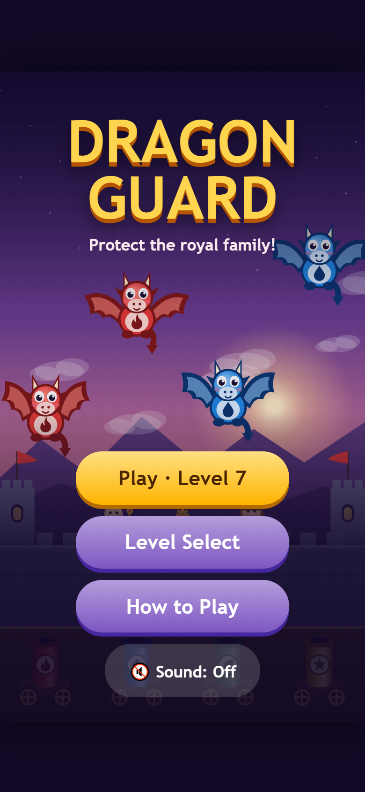
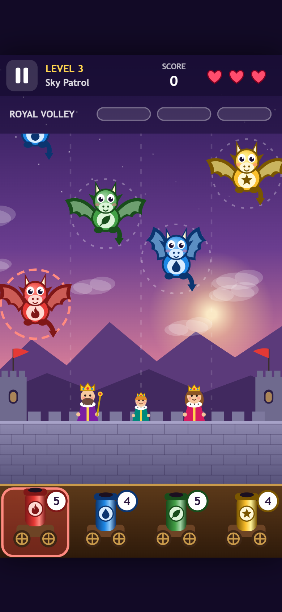
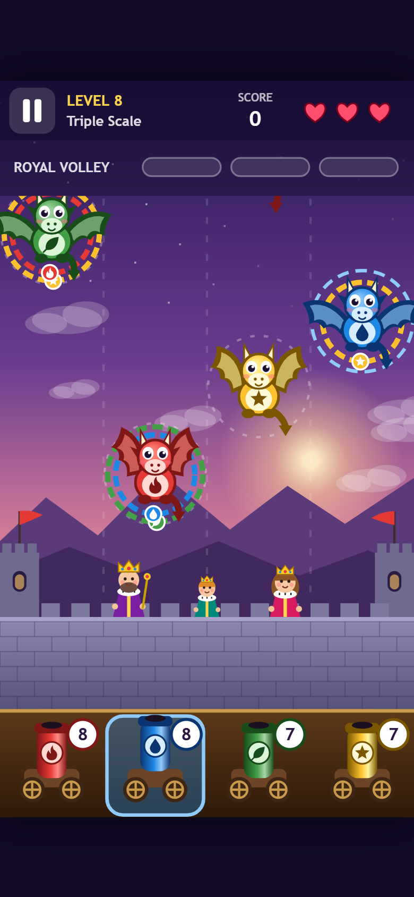
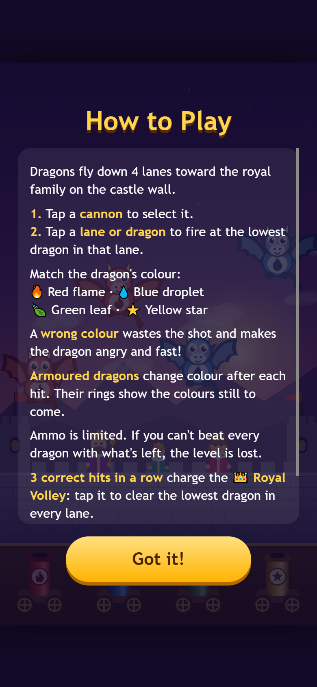
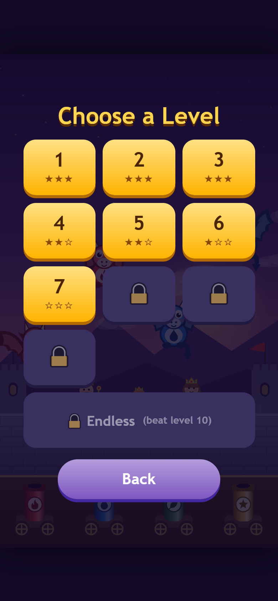
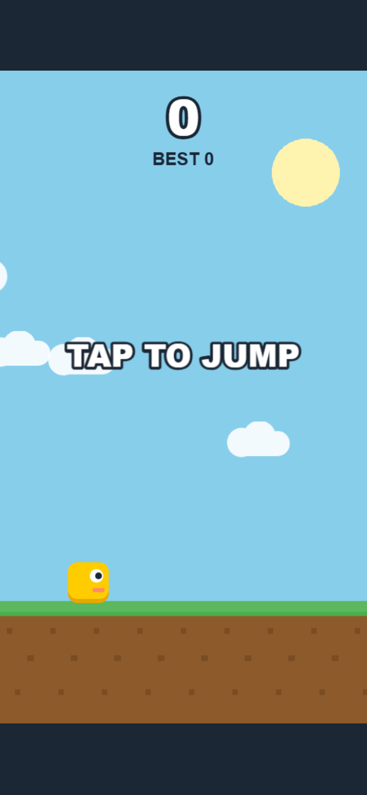

# 🐉 Dragon Guard

**Protect the royal family!** Dragon Guard is a colour-matching defence game for the browser, built for phones held in portrait but playable on desktop too. Dragons fly down four lanes toward the king, queen and prince on the castle wall. Fire the matching cannon before they get there.

### ▶️ [Play Dragon Guard](https://davidvelceski1-cloud.github.io/dragon-guard/)

Bonus mini-game in the same repo: **[Jumpy Box](https://davidvelceski1-cloud.github.io/dragon-guard/jumpy-box.html)**

<p align="center">
  
  
  
</p>

## How to play

1. **Tap a cannon** at the bottom to select it.
2. **Tap a lane or a dragon** to fire at the lowest dragon in that lane.
3. **Match the colour.** Each colour also has a symbol, so the game works for colour-blind players:
   🔥 red flame · 💧 blue droplet · 🍃 green leaf · ⭐ yellow star
4. A **wrong colour** wastes the shot and makes the dragon angry and much faster.
5. **Armoured dragons** change colour each time you hit them. The rings around them show the colours still to come.
6. **Ammo is limited.** The number on each cannon shows how many shots it has left. If you can't beat every dragon with what's left, the level is lost.
7. **3 correct hits in a row** charge the 👑 **Royal Volley**. Tap it to clear the lowest dragon in every lane.
8. Each dragon that reaches the wall costs a ❤️. Lose all 3 and the castle falls.

## Levels

| # | Level | What's new |
|---|-------|-----------|
| 1 | First Flight | Tutorial: red and blue only, slow dragons |
| 2 | Four Colours | All four colours and their symbols |
| 3 | Sky Patrol | Royal Volley |
| 4 | Twin Wings | Dragons arrive two at a time |
| 5 | Ember Rush | Tight ammo |
| 6 | Armoured Scales | Two-layer armoured dragons |
| 7 | Shifting Shields | More armour, less spare ammo |
| 8 | Triple Scale | Three-layer armour |
| 9 | Storm Front | Fast waves, exact ammo |
| 10 | Dragonstorm | The final test |
| ∞ | Endless | Unlocks after level 10. Waves keep getting bigger and faster |

Each level is scored out of 3 stars. You get bonus points for hearts and cannonballs left over. Progress, best scores and the sound setting are saved in your browser.

<p align="center">
  
  
</p>

## Jumpy Box

A one-button runner. Tap (or press <kbd>Space</kbd>) to jump over obstacles. A short tap gives a short hop and holding gives a full jump. Built with [Phaser 3](https://phaser.io/).

<p align="center">
  
</p>

## Running it locally

There's no build step. Dragon Guard uses plain JavaScript files (no modules), so you can open `index.html` straight from disk or serve the folder:

```bash
git clone https://github.com/davidvelceski1-cloud/dragon-guard.git
cd dragon-guard
npx serve .        # or: python -m http.server
```

Jumpy Box loads Phaser from a CDN, so it needs an internet connection.

## Project layout

```
index.html        Dragon Guard page and menu screens
style.css         Layout, overlays and responsive letterboxing
js/config.js      Every tunable constant: layout, speeds, scoring, colours, endless tuning
js/levels.js      Level data (spawn times, lanes, armour layers, ammo)
js/game.js        Game state and rules
js/render.js      Canvas drawing: dragons, castle, cannons, effects
js/input.js       Touch and mouse input
js/ui.js          Title, level select, pause and results screens
js/audio.js       Sound effects (Web Audio)
js/storage.js     Save data in localStorage
js/main.js        Boot, responsive layout and the game loop
jumpy-box.html    Jumpy Box, all in one file (Phaser 3)
```

To add or tweak a level, edit `js/levels.js`. The comment at the top of that file explains the format.
